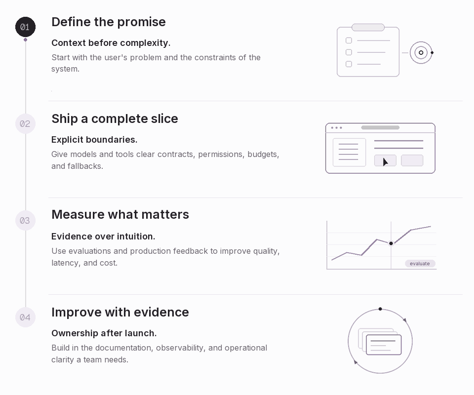

<a href="https://nikeshh.com">
<picture>
  <source media="(prefers-reduced-motion: reduce)" srcset="./assets/engineering-banner.png" />
  
</picture>
</a>

 

**AI Engineer &nbsp; / &nbsp; Full-Stack Builder &nbsp; / &nbsp; Platform Engineer**

[**Website ↗**](https://nikeshh.com) &nbsp;&nbsp; [**LinkedIn ↗**](https://www.linkedin.com/in/nikeshh/) &nbsp;&nbsp; [**X ↗**](https://x.com/NikeshhV) &nbsp;&nbsp; [**Say hello ↗**](https://nikeshh.com/?contact=1)

 

## Building systems people can rely on.

I'm **Nikeshh Vijayabaskaran**. I build assistants, retrieval systems, and agentic workflows, connecting the intelligence layer to the product and infrastructure around it. My background spans **RBC and Temenos**, from banking applications and distributed services to cloud platforms and AI engineering.

The aim is simple: **calm, reliable products that people can use and teams can operate.**

## Focus

| | What I work on | What matters |
| :--- | :--- | :--- |
| **01 / Intelligence** | LLM systems, retrieval, agents, tool integration | Grounded answers, useful context, clear boundaries |
| **02 / Experience** | Full-stack products, AI interfaces, APIs | Coherent workflows, thoughtful UX, responsive feedback |
| **03 / Infrastructure** | Cloud platforms, event pipelines, model deployment | Predictable latency, resilience, cost |
| **04 / Confidence** | Evaluations, tracing, observability, runbooks | Measurable quality, visible failures, clear ownership |

## Toolbox

| | Tools | Practices |
| :--- | :--- | :--- |
| **01 / AI** | &nbsp;Python | LLMs & retrieval · Agents & tools Evaluations · Model deployment |
| **02 / Product** | &nbsp;TypeScript &nbsp; &nbsp;Python &nbsp; &nbsp;React &nbsp;Next.js &nbsp; &nbsp;Node.js &nbsp; &nbsp;Java &nbsp;Spring&nbsp;Boot &nbsp; &nbsp;Vue &nbsp; &nbsp;Angular | Typed applications · Interfaces · APIs |
| **03 / Data** | &nbsp;PostgreSQL &nbsp; &nbsp;MongoDB &nbsp; &nbsp;Redis &nbsp;Kafka &nbsp; &nbsp;RabbitMQ | Persistence · Caching · Event streaming |
| **04 / Infrastructure** | &nbsp;Docker &nbsp; &nbsp;Kubernetes &nbsp; &nbsp;AWS &nbsp;GCP &nbsp; &nbsp;Azure &nbsp; &nbsp;Terraform &nbsp;Helm &nbsp; &nbsp;Jenkins | Cloud · Deployment · Infrastructure as code |
| **05 / Observability** | &nbsp;Prometheus &nbsp; &nbsp;Grafana &nbsp; &nbsp;OpenTelemetry | Metrics · Tracing · CI/CD |

## How I work

<picture>
  <source media="(prefers-reduced-motion: reduce)" srcset="./assets/workflow.png" />
  
</picture>

- **Context before complexity.** Start with the user's problem and the constraints of the system.
- **Explicit boundaries.** Give models and tools clear contracts, permissions, budgets, and fallbacks.
- **Evidence over intuition.** Use evaluations and production feedback to improve quality, latency, and cost.
- **Ownership after launch.** Build in the documentation, observability, and operational clarity a team needs.

 

---

### A clear problem is a good place to start.

Building an AI product, connecting a knowledge layer, or making a platform more dependable?

[**Let's talk ↗**](https://nikeshh.com/?contact=1) &nbsp; · &nbsp; [**nikeshh.com ↗**](https://nikeshh.com)

