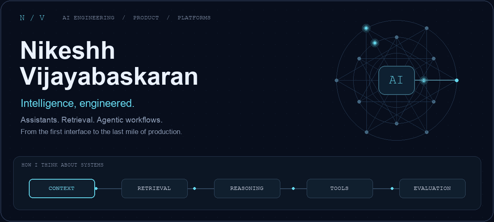

<a href="https://nikeshh.com">
<picture>
  <source media="(prefers-reduced-motion: reduce)" srcset="./assets/engineering-banner.png" />
  
</picture>
</a>

 

**AI Engineer &nbsp; / &nbsp; Full-Stack Builder &nbsp; / &nbsp; Platform Engineer**

[**Website ↗**](https://nikeshh.com) &nbsp;&nbsp; [**LinkedIn ↗**](https://www.linkedin.com/in/nikeshh/) &nbsp;&nbsp; [**X ↗**](https://x.com/NikeshhV) &nbsp;&nbsp; [**Say hello ↗**](https://nikeshh.com/?contact=1)

 

## Building systems people can rely on.

I'm **Nikeshh Vijayabaskaran**.

I build AI products end to end: voice agents and receptionists that never miss a call, lead generation and sales systems that capture leads and close deals, and marketing, SEO, and AIO engines that grow your traffic and visibility.

I also automate support, finance, HR, and operations, and keep it all auditable, compliant, and governed.

Working across banking, healthcare, retail and ecommerce, education, real estate, manufacturing, logistics, hospitality, technology, and professional services taught me to care about the details: how a product feels, how reliably it runs, and how well a team can understand it.

The aim is simple: **calm, reliable products that people can use and teams can operate.**

## Services

AI products and automation built around the way your business works.

| | Service | What it includes |
| :--- | :--- | :--- |
| **01** | **AI receptionists & voice agents** | Call answering & routing · Calendar bookings & reminders · Human handoff & call summaries |
| **02** | **Lead generation & qualification** | Website enquiry capture · Qualification questions · Meeting booking & lead routing |
| **03** | **Sales & CRM automation** | Customer record updates · Follow-up sequences · Pipeline alerts & sales handoffs |
| **04** | **Marketing automation** | Content & campaign drafts · Customer nurture journeys · Audience segmentation & review |
| **05** | **Chatbots & customer support** | Knowledge-grounded answers · Ticket routing & escalation · Aftercare & customer check-ins |
| **06** | **Financial automation** | Invoice & receipt capture · Payment reminders · Reconciliation preparation |
| **07** | **Workflow automation** | App integrations & data entry · Scheduling & notifications · Approvals & exception handling |
| **08** | **Business process automation** | Customer onboarding · Document & request processing · Department handoffs & tracking |
| **09** | **HR automation** | Employee onboarding checklists · Policy & internal knowledge assistants · Leave requests & HR reminders |
| **10** | **Job & field operations** | Job scheduling & dispatch support · Visit updates & work summaries · Aftercare follow-ups |
| **11** | **Reporting & AI advisory** | Automation assessment & tool selection · Operational dashboards & reports · Evaluation, monitoring & improvement |
| **12** | **SEO & AIO** | Technical SEO & structured data · AI search & content optimisation · Search visibility & discovery reporting |
| **13** | **Growth hacking & traffic** | Acquisition & traffic experiments · Landing page & conversion testing · Funnel analytics & growth reporting |
| **14** | **AI auditing & assurance** | Model, prompt & workflow reviews · Quality, safety & failure-mode evaluations · Traceability & audit trails |
| **15** | **Compliance & AI governance** | Data handling & access controls · Human oversight & approval workflows · Policy documentation & compliance evidence |

## Focus

| | What I work on | What matters |
| :--- | :--- | :--- |
| **01 / Intelligence** | LLM systems, retrieval, agents, tool integration | Grounded answers, useful context, clear boundaries |
| **02 / Experience** | Full-stack products, AI interfaces, APIs | Coherent workflows, thoughtful UX, responsive feedback |
| **03 / Infrastructure** | Cloud platforms, event pipelines, model deployment | Predictable latency, resilience, cost |
| **04 / Confidence** | Evaluations, tracing, observability, runbooks | Measurable quality, visible failures, clear ownership |

## Toolbox

| | Tools | Practices |
| :--- | :--- | :--- |
| **01 / AI** | &nbsp;Python &nbsp; &nbsp;TensorFlow &nbsp; &nbsp;scikit-learn | Model development · LLMs & retrieval · Agents & tools · Evaluations |
| **02 / Product** | &nbsp;TypeScript &nbsp; &nbsp;JavaScript &nbsp; &nbsp;React &nbsp;Next.js &nbsp; &nbsp;Node.js &nbsp; &nbsp;Java &nbsp;Spring&nbsp;Boot &nbsp; &nbsp;Vue &nbsp; &nbsp;Angular &nbsp;Firebase | Typed applications · Interfaces · APIs · Authentication |
| **03 / Web** | &nbsp;HTML &nbsp; &nbsp;CSS &nbsp; &nbsp;Tailwind&nbsp;CSS | Accessible interfaces · Responsive layouts · Styling |
| **04 / Data** | &nbsp;PostgreSQL &nbsp; &nbsp;MongoDB &nbsp; &nbsp;Redis &nbsp;Oracle &nbsp; &nbsp;DynamoDB &nbsp; &nbsp;Elasticsearch | Relational & document stores · Caching · Search |
| **05 / Integration** | &nbsp;Kafka &nbsp; &nbsp;RabbitMQ &nbsp; &nbsp;AWS&nbsp;Kinesis &nbsp;Azure&nbsp;Event&nbsp;Hubs &nbsp; &nbsp;Apache&nbsp;Camel &nbsp; &nbsp;Apache&nbsp;Atlas | Event streaming · Messaging · Routing · Data governance |
| **06 / Infrastructure** | &nbsp;Docker &nbsp; &nbsp;Kubernetes &nbsp; &nbsp;OpenShift &nbsp;AWS &nbsp; &nbsp;GCP &nbsp; &nbsp;Azure &nbsp;Amazon&nbsp;EKS &nbsp; &nbsp;Terraform &nbsp; &nbsp;Ansible &nbsp;Helm | Containers · Cloud · Infrastructure as code |
| **07 / Observability** | &nbsp;Prometheus &nbsp; &nbsp;Grafana &nbsp; &nbsp;OpenTelemetry &nbsp;Jaeger &nbsp; &nbsp;Logstash &nbsp; &nbsp;Kibana | Metrics · Distributed tracing · Logs · Dashboards |
| **08 / Delivery** | &nbsp;Git &nbsp; &nbsp;GitHub &nbsp; &nbsp;Jenkins &nbsp;Maven &nbsp; &nbsp;Selenium &nbsp; &nbsp;Jira | Version control · CI/CD · Test automation · Planning |

## How I work

<picture>
  <source media="(prefers-reduced-motion: reduce)" srcset="./assets/workflow.png" />
  
</picture>

 

---

### A clear problem is a good place to start.

Building an AI product, automating operations, or improving your traffic and visibility?

[**Let's talk ↗**](https://nikeshh.com/?contact=1) &nbsp; · &nbsp; [**nikeshh.com ↗**](https://nikeshh.com)

